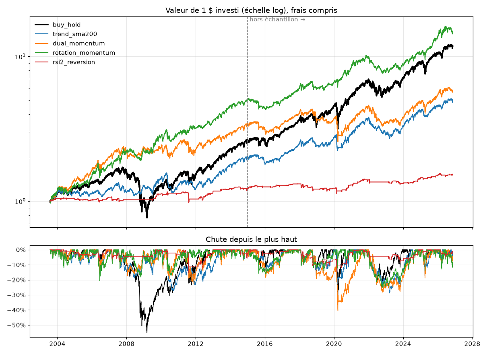

# Rapport de backtest

Période : **01/08/2003 → 11/11/2026**. Frais et glissement : 0.10 % par achat ou vente.
Décision à la clôture, exécution à l'ouverture du lendemain. Le cash ne rapporte rien ici.

> Un backtest décrit le passé, pas l'avenir. Ces stratégies sont connues de tous
> depuis des années : leurs bons résultats passés ont pu être arbitrés depuis.

## Les stratégies
- `buy_hold` : Référence : 100 % S&P 500 gardé en permanence
- `trend_sma200` : S&P 500 au-dessus de sa moyenne 200 jours, sinon obligations
- `dual_momentum` : Momentum dual mensuel : US ou international, sinon obligations
- `rotation_momentum` : Rotation mensuelle sur les 3 ETF au momentum le plus fort
- `rsi2_reversion` : Achat des replis courts du S&P 500 (RSI 2 jours)

## Verdict (période hors échantillon, depuis 2015)
- `trend_sma200` : rapporte moins que l'indice ; son seul atout est de limiter les chutes.
- `dual_momentum` : **ne fait pas mieux** que garder l'indice.
- `rotation_momentum` : rapporte moins que l'indice ; son seul atout est de limiter les chutes.
- `rsi2_reversion` : rapporte moins que l'indice ; son seul atout est de limiter les chutes.

## Hors échantillon (2015 → aujourd'hui)
| Stratégie | Rendement annuel | Volatilité | Sharpe | Pire chute | Calmar | Temps investi | Rotation / an | Multiplicateur |
|---|---|---|---|---|---|---|---|---|
| `buy_hold` | +13.5% | 18% | 0.81 | -33.7% | 0.40 | 100% | 0.0× | ×4.5 |
| `trend_sma200` | +8.0% | 13% | 0.68 | -28.8% | 0.28 | 100% | 10.5× | ×2.5 |
| `dual_momentum` | +4.6% | 16% | 0.36 | -40.5% | 0.11 | 100% | 4.7× | ×1.7 |
| `rotation_momentum` | +9.6% | 14% | 0.73 | -25.0% | 0.38 | 100% | 6.0× | ×3.0 |
| `rsi2_reversion` | +1.9% | 6% | 0.35 | -14.5% | 0.13 | 11% | 17.6× | ×1.3 |

## En échantillon (avant 2015)
| Stratégie | Rendement annuel | Volatilité | Sharpe | Pire chute | Calmar | Temps investi | Rotation / an | Multiplicateur |
|---|---|---|---|---|---|---|---|---|
| `buy_hold` | +8.7% | 19% | 0.53 | -55.2% | 0.16 | 100% | 0.0× | ×2.6 |
| `trend_sma200` | +6.2% | 12% | 0.56 | -27.4% | 0.23 | 100% | 15.1× | ×2.0 |
| `dual_momentum` | +11.3% | 15% | 0.78 | -23.0% | 0.49 | 100% | 2.5× | ×3.4 |
| `rotation_momentum` | +15.1% | 15% | 0.98 | -20.6% | 0.73 | 100% | 5.0× | ×5.0 |
| `rsi2_reversion` | +1.8% | 6% | 0.31 | -15.5% | 0.12 | 11% | 15.3× | ×1.2 |

## Toute la période
| Stratégie | Rendement annuel | Volatilité | Sharpe | Pire chute | Calmar | Temps investi | Rotation / an | Multiplicateur |
|---|---|---|---|---|---|---|---|---|
| `buy_hold` | +11.2% | 19% | 0.66 | -55.2% | 0.20 | 100% | 0.0× | ×11.7 |
| `trend_sma200` | +7.1% | 12% | 0.62 | -28.8% | 0.25 | 100% | 12.7× | ×4.9 |
| `dual_momentum` | +7.8% | 16% | 0.56 | -40.5% | 0.19 | 100% | 3.7× | ×5.8 |
| `rotation_momentum` | +12.2% | 15% | 0.86 | -25.0% | 0.49 | 100% | 5.5× | ×14.6 |
| `rsi2_reversion` | +1.9% | 6% | 0.33 | -15.5% | 0.12 | 11% | 16.4× | ×1.5 |

## Année par année
| Année | `buy_hold` | `trend_sma200` | `dual_momentum` | `rotation_momentum` | `rsi2_reversion` |
|---|---|---|---|---|---|
| 2003 | +12.9% | +12.9% | +19.0% | +17.3% | +4.3% |
| 2004 | +10.7% | +2.6% | +19.0% | +10.8% | +0.3% |
| 2005 | +4.8% | -4.4% | +13.3% | +12.1% | -2.6% |
| 2006 | +15.8% | +8.7% | +25.8% | +22.0% | +4.8% |
| 2007 | +5.1% | -5.8% | +10.0% | +22.3% | -4.0% |
| 2008 | -36.8% | +11.7% | +5.4% | +3.2% | +0.0% |
| 2009 | +26.4% | +12.1% | -0.8% | +23.6% | +9.3% |
| 2010 | +15.1% | -10.1% | +5.3% | +5.4% | +0.8% |
| 2011 | +1.9% | -5.9% | -8.9% | +7.7% | -8.2% |
| 2012 | +16.0% | +12.9% | +16.0% | +11.8% | +11.5% |
| 2013 | +32.3% | +32.3% | +15.3% | +29.2% | +5.7% |
| 2014 | +13.5% | +11.2% | +13.5% | +8.9% | +0.3% |
| 2015 | +1.2% | -8.9% | -6.6% | -11.7% | +2.6% |
| 2016 | +12.0% | +11.1% | +6.2% | +11.0% | +2.0% |
| 2017 | +21.7% | +21.7% | +19.4% | +21.9% | +2.7% |
| 2018 | -4.6% | -2.0% | -7.6% | +1.7% | -7.9% |
| 2019 | +31.2% | +13.1% | -0.7% | +8.7% | +1.4% |
| 2020 | +18.3% | +7.0% | -4.0% | +26.6% | +5.3% |
| 2021 | +28.7% | +28.7% | +28.7% | +18.8% | +8.4% |
| 2022 | -18.2% | -24.1% | -25.1% | -21.8% | -3.3% |
| 2023 | +26.2% | +15.6% | +11.3% | +14.4% | -2.4% |
| 2024 | +24.9% | +24.9% | +24.9% | +15.6% | +8.9% |
| 2025 | +17.7% | +9.6% | +13.1% | +30.2% | +5.0% |
| 2026 | +12.3% | +9.9% | +8.0% | +10.2% | +1.5% |

### Lexique
- **Rendement annuel** : gain moyen par an, composé.
- **Pire chute** : la plus forte baisse depuis un sommet (ce que tu aurais vécu de pire).
- **Sharpe** : rendement par unité de risque. Plus c'est haut, mieux c'est.
- **Calmar** : rendement annuel divisé par la pire chute.
- **Rotation / an** : combien de fois le capital est échangé par an (frais).
